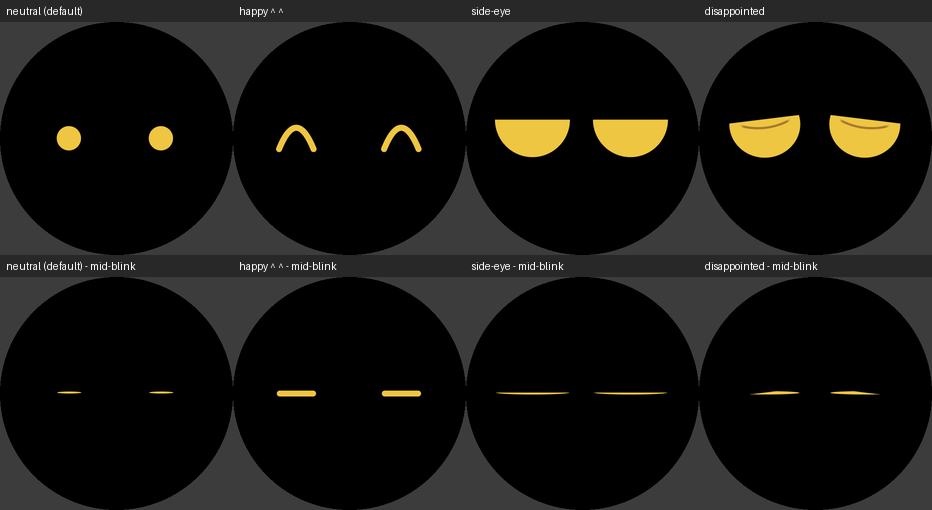
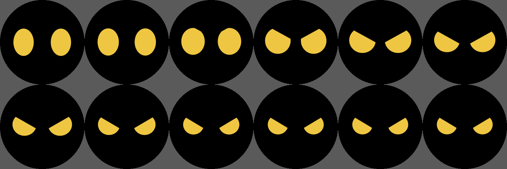
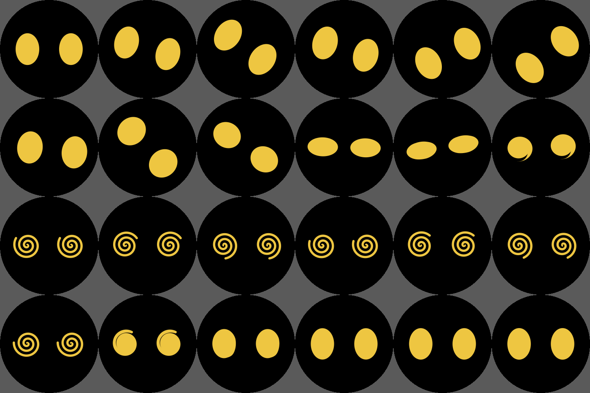
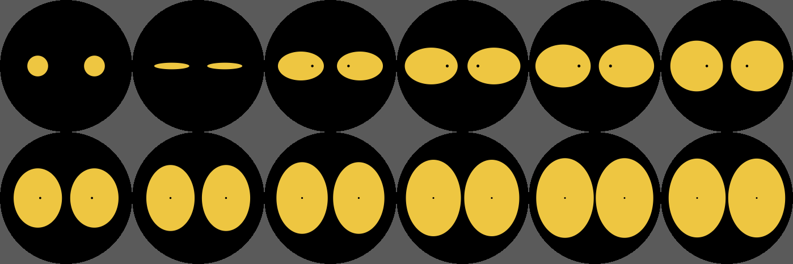
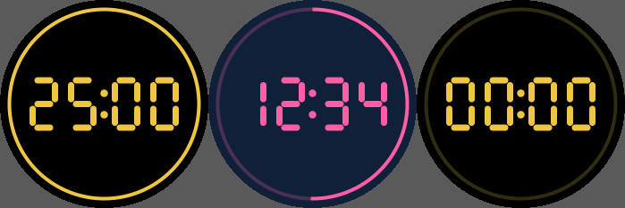

# EyeBuddy firmware

Yellow cartoon eyes for the **Waveshare ESP32-S3-Touch-AMOLED-1.43** that blink and look around by themselves, react
to touch, and react to you through the `eyebuddy-web` app (webcam, over USB or Bluetooth).



**Ready-made firmware:** download `EyeBuddy-firmware.bin` from the
[releases](https://github.com/softobsessing/doomscroll-eyes/releases) and flash it at **0x0** with
https://espressif.github.io/esptool-js/ (Chrome). No Arduino needed. That manual flash erases saved pairings; after
the first time, use **Update firmware** on the website instead (keeps them).

`preview/eyebuddy_session.gif` is a simulated session rendered on the Mac from this exact code.

| Expression | When |
|---|---|
| tall ovals (focused) | default; always blinking (every 2–6 s, sometimes double), drifting slightly, following your face |
| round dots (chilling) | the website's **chilling** button |
| glare → squint (angry) | the website's **angry** button: grows out of the focused ovals (lids slide down, then narrow) |
| wobble → swirls (dizzy) | the website's **dizzy** button: the eyes rock around the face, flatten, spin as swirls for 1 s, then melt back into the focused ovals |



| `^ ^` happy | you come back to the screen, or you touch it |
| half-moons (side-eye) | your eyes leave the laptop screen (right away) |
| droopy lids (disappointed) | still looking away 2 s later |
| growing ovals (surprised) | the website's **surprised** button: blink, then the eyes grow through four shapes (small wide ovals → wider, pupils glancing in → tall → huge) and stay big |



**Pomodoro:** the website's pomodoro button: surprised eyes, 2 s of the timer screen, then focused eyes for 25 min.
During it, a touch shows the time left for 2 s (instead of the smile). The board counts down by itself, so this works
even with the website closed; at the end it shows `00:00` for 3 s. If the website's camera sees you look away for
more than 1 s during the session, it sends `angry`; when you look back it sends `neutral` and the eyes settle back
into the focused ovals over 0.7 s (lids lift, no blink).



**Colors:** the website's color wheel sets the eye color and the screen color (`K` line below). The board saves
the last colors in flash (1.5 s after you stop changing them), so they survive a restart.

Expression changes always happen mid-blink, so the eyes close in one mood and open in the next.

## Touch
- **any touch**: the welcome-back smile right away, for as long as your finger stays plus 2.5 s after.
- **during a pomodoro**: the time left, for 2 s.
  With no laptop connected the eyes look at your finger.
- **TAP TO PAIR** on screen: a computer wants to pair over Bluetooth; touch to accept (30 s).
- **hold 10 s**: forget every paired computer (countdown `RESET IN 5…1`, then `RESET`).

Connecting the web app makes the eyes blink hello. For 5 s after power-on the screen shows the board's ID
(`ID 3F2A`, from the chip's MAC); its Bluetooth name is `EyeBuddy-3F2A`.

## Pairing (one board per computer)
USB is trusted (plugging in = physical access). Over Bluetooth the board only obeys computers whose key it has
(up to 8, stored in NVS, kept across power-off and web updates). Each connection: the board sends a one-time nonce
in `HELLO`, the computer answers `A <HMAC-SHA256(key, nonce)>`. A new computer sends `PAIR <key>` and someone has
to touch the board. One controller at a time (`BUSY`), one Bluetooth connection at a time (no advertising while
connected). All of this lives in `brain.cpp` / `pairing.cpp` / `sha256.cpp` and is tested on the Mac.

## Upload

### Arduino IDE
1. Boards Manager: install **esp32 by Espressif Systems** (tested with 3.3.12).
2. Open `EyeBuddy/EyeBuddy.ino`. Tools menu:
   - Board: **ESP32S3 Dev Module**
   - USB CDC On Boot: **Enabled** (needed for the web app's USB connection)
   - Flash Size: **16MB (128Mb)**
   - PSRAM: **OPI PSRAM**
   - Partition Scheme: **16M Flash (3MB APP/9.9MB FATFS)**
3. Upload. No extra libraries are needed (no LVGL).

If upload can't find the board: hold **BOOT**, tap **RESET**, release BOOT, then upload again.

### Command line (from this folder's parent)
```
~/.local/arduino-cli/arduino-cli compile --fqbn "esp32:esp32:esp32s3:CDCOnBoot=cdc,FlashSize=16M,PSRAM=opi,PartitionScheme=app3M_fat9M_16MB" --output-dir EyeBuddy/build EyeBuddy
~/.local/arduino-cli/arduino-cli upload  --fqbn "esp32:esp32:esp32s3:CDCOnBoot=cdc,FlashSize=16M,PSRAM=opi,PartitionScheme=app3M_fat9M_16MB" -p /dev/cu.usbmodem* --input-dir EyeBuddy/build EyeBuddy
```
To go back to the Waveshare factory clock: `esp32-tools/venv/bin/esptool.py --chip esp32s3 write_flash 0x0 ESP32-S3-Touch-AMOLED-1.43-factory.bin`.

## Settings (`config.h`)
- `SCREEN_ROTATION`: 270 matches the Waveshare demo. If the eyes are sideways on your mount, try 0 / 90 / 180.
- `SCREEN_BRIGHTNESS`: 0–255.
- `BLE_NAME`: prefix of the Bluetooth name (`EyeBuddy-<ID>`); keep it unless you change the web app too.
- `FW_VERSION`: bump for each release, then run `python3 ../make_web_fw.py` after compiling.

## Protocol v4 (USB serial and Bluetooth Nordic UART, text lines)
```
laptop -> board   P                                         hello? -> HELLO with a fresh nonce
                  A <32 hex>                                HMAC-SHA256(key, nonce)[0..16] -> AUTH ok | AUTH no
                  PAIR <32 hex key>                         USB: saved now. Bluetooth: TAP TO PAIR -> AUTH wait/ok/timeout
                  E <neutral|happy|side|sad|wow|chill|angry|dizzy> <lookX> <lookY>   (~20/s; -100..100; neutral = focused, wow = surprised, chill = chilling)
                  K <screen RRGGBB> <eyes RRGGBB>           colors
                  M <secondsLeft> <totalSeconds>            pomodoro; M 0 0 = stop
                  S                                         show the time left for 2 s
                  B | B2                                    blink now / double blink
board -> laptop   HELLO EyeBuddy 4 <id> <fw> <nonce>        (protocol 3 = firmware v5, no pairing)
                  AUTH ok|no|wait|timeout|need              need = E/B/K/M/S before AUTH ok (Bluetooth)
                  BUSY                                      another link is driving the eyes
                  T touch | T release | T reset             (during a pomodoro a touch shows the time left)
                  D fps <n> worst_ms <n>     (USB only, every 10 s, for debugging)
```
lookX + = toward the right side of the board's screen, lookY + = down. If no `E` line arrives for 3 s the board
goes back to idle (neutral, looking around). Bluetooth notifications and writes are split into 20-byte pieces.

**Lockstep with the website.** While connected, the web app's screen preview is the clock: the board turns off its own
random blinks and glances, blinks when it gets `B`, and its glances arrive inside the `E` look values. So the board shows
the same thing as the preview, at the same moment (within a frame plus the USB/Bluetooth delay). On its own it blinks by itself.

Each frame both eyes are shaded first (into a full-screen copy in PSRAM) and then sent to the panel together, so the left
and right eye always change at the same time. PSRAM must be enabled (OPI PSRAM).

## Code
- `eyes.cpp`: shapes (signed-distance drawing with anti-aliasing), blinking, gaze. Plain C++.
- `brain.cpp`: touch beats laptop beats idle; protocol parsing. Plain C++.
- `render.cpp`: rotation, redraws only the boxes around the eyes, two DMA buffers.
- `display.c`: panel init (Waveshare's init commands, no LVGL). `touch.cpp`: FT3168 over Wire.
- `ble_link.cpp`: Bluetooth Nordic UART service (one connection at a time, 20-byte pieces).
- `pairing.cpp`, `sha256.cpp`: paired computers' keys, HMAC challenge. `text.cpp`: the pixel-font line under the eyes.

Mac checks (in the original project folder, not in this repo) `tools/eyebuddy_preview/`: `test_brain` (logic), `test_render` (panel output pixel-exact vs the eye
engine), `preview stills|anim|bench` (images).

## Website preview check
The website's preview (`eyes.js`) is a port of `eyes.cpp`. After changing shapes, colors or timings in either, check
they still match pixel by pixel (from the repo root):
```
clang++ -O2 -std=c++17 -o /tmp/parity firmware/EyeBuddy/extras/parity.cpp firmware/EyeBuddy/eyes.cpp
/tmp/parity /tmp/parity_out && node test/eyes_port.test.mjs /tmp/parity_out
```
